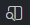

# react-exercises

Repositório de exercícios de React para a turma. O repositório começa vazio de propósito: o primeiro exercício é criar o projeto com Vite.

## Estrutura de um exercício

Cada exercício possui sua própria pasta na raiz do projeto, contendo dois arquivos Markdown:

- `INSTRUCTIONS.md` — enunciado, requisitos e passos a seguir.
- `RESULT.md` — onde você registra, com suas próprias palavras, o que fez, as dificuldades e o que aprendeu.

A localização dos demais arquivos e a estrutura do projeto são definidas no enunciado de cada exercício.

## Regras

1. Um `push` deve ser relativo a um único exercício (pode conter vários commits, mas um único push por exercício).
2. Sempre execute `npm run build` antes de commitar e fazer push.
3. O `RESULT.md` deve descrever com suas próprias palavras como chegou no resultado, quais foram as dificuldades e o que aprendeu. Não use IA para gerar esse resumo — no máximo para correções ortográficas.
4. Um exercício pode depender da conclusão de um anterior (os requisitos estarão descritos no `INSTRUCTIONS.md`).

## Como começar

1. Clone este repositório.
2. Leia o `INSTRUCTIONS.md` do próximo exercício disponível.
3. Siga as instruções e preencha o `RESULT.md`.
4. Rode `npm run build`.
5. Commit e push.

## Dicas

No canto superior direito do seu VSCODE existe um botão que ao abrir este arquivo.md, exibe ele em modo "visualização" e ajuda na sua leitura. 
